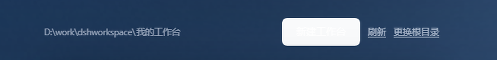
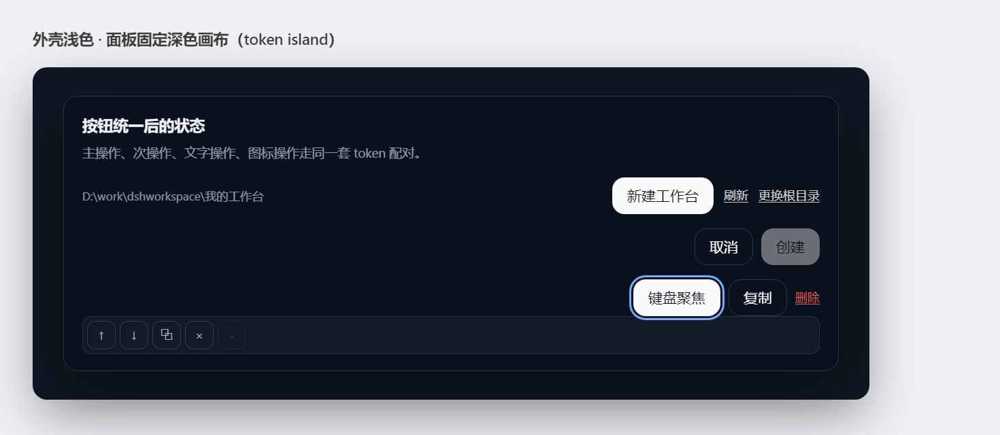
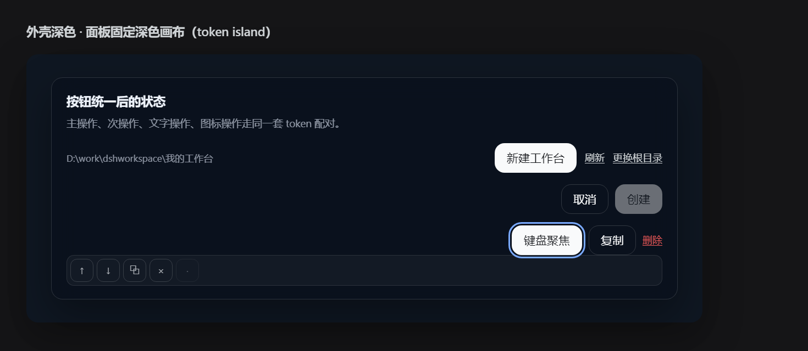

# 按钮样式与交互规范（Workbench 插件）

本仓库界面上所有按钮（主操作、次操作、行内链接、图标按钮、可点击卡片）统一到一套规范：**结构取自官网的产品按钮体系，颜色一律走 DSH 外壳的 design token，交互行为按下面第 4 节落地。** 2026-11-04 已按 5.2 落地第一批（primary / secondary / link / icon-btn），实施记录与验证见 5.4。

## 1. 为什么现在有的按钮是白的

截图里的「新建工作台」是一个白底按钮，文字几乎看不见：



根因在 `src/client/workbench.ts:64`：

```css
.dshwb-primary{
  background:var(--dsw-alias-brand-primary);
  color:#fff; /* ← 硬编码，和背景没有配对关系 */
}
```

外壳 dark 主题里 `--dsw-alias-brand-primary` 的值是 **`#f9fafb`（近白）**，配对的前景色 token 是 `--dsw-alias-label-primary-foreground` = **`#0f1115`（近黑）**。插件写死 `color:#fff`，于是白底白字，对比度约 **1.04:1**。

这不是一处笔误，而是一类问题：

| 问题 | 现状 | 后果 |
| --- | --- | --- |
| 颜色写死 | `#fff`、`#eef3fb`、`rgba(255,255,255,.18)`、`rgba(226,234,248,.68)` 散落在各组件的 CSS 字符串里 | dark 主题下 primary 文字不可见；light 主题下 secondary / link / icon 反而不可见（白底浅字） |
| 焦点环用填充色 | `outline-color: var(--dsw-alias-brand-primary)`（`workbench.ts:67`、`config-drawer.ts:65`、`renderers/harness.ts:39`） | primary 按钮在 dark 下填充≈白、焦点环≈白，键盘聚焦时看不到环 |
| 尺寸碎片化 | 圆角 6/8/9/10/11/14px；内边距 4/5/7/8px；字号 11/11.5/12/12.5/13/13.5px；hover 有 `filter`、`transform`、`background` 三种写法 | 同一层级的按钮长得不一样，hover/按下反馈不统一 |
| 状态缺失 | secondary / link / icon 没有 `:active`、`[aria-busy]`；icon 按钮 22px 低于 28px 命中区 | 密度与可点性不足 |

**结论**：按钮颜色必须成对使用 token（填充 + 前景），禁止任何字面量白色；焦点环跟随外壳全局焦点规则；尺寸/圆角/动效收敛到第 3 节的一张表。

## 2. 参考：官网按钮是怎么配的

取证方式：抓取 <https://www.deepseek.com/en/harness/> 及其 4 个 CSS bundle（`/_next/static/css/ddd6172044536759.css`、`be6cf46335e70ac8.css`、`aa0e993381ed79dc.css`、`c10abea4914501ec.css`），并对照本机 DSH 桌面版 `app.asar` 里的主题包（`@deepseek-ai/dsh-client-ui-theme`）与成品按钮（侧栏 `_newSession`、设置页 `primaryButton`、前端 `_button`）。

官网其实有**两套**按钮，职责不同：

| 体系 | 类名 | 用在哪 | 形状 | 本插件是否采用 |
| --- | --- | --- | --- | --- |
| 产品设计系统 | `.ds-button` + `--filled/--outlined/--borderless/--icon/--text` + `--xl/--l/--m/--s/--xs` + `--primary/--error/--warning` | 产品界面本身（应用内按钮） | 默认 pill（4096px），`--roundRect` 时 8/10px | **结构与状态逻辑采用** |
| 落地页 CTA | `.ds-btn-primary/--secondary/--ghost/--text` + `.ds-btn-m/s/xs` | 官网营销页（Download Desktop、GitHub、社区插件…） | pill（`--ds-radius-pill:100px`） | 仅借用 hover 动效，不用于应用内 |

### 2.1 产品设计系统 `.ds-button` 的配置

`.ds-button` 是三个正交轴的组合，不是固定几个按钮：

- **kind**：`--filled`（实心）/ `--outlined`（描边）/ `--borderless`（无框）/ `--icon`（图标）/ `--text`（纯文字）
- **size**：`--xl --l --m --s --xs`，另有 `--text`（自适应高度）、`--circle`、`--roundRect`
- **tone**：`--primary`（主操作）/ `--outlinedNeutral`、`--borderlessNeutral`（中性）/ `--error`、`--warning`（危险、警示）/ 图标变体的 `--iconLabelPrimary/Secondary/Tertiary`
关键状态规则（从 CSS 原文归纳；选择器做了简写）：

```css
/* 实心主操作：填充/前景成对，hover 换填充，焦点环独立 */
.ds-button--filled.ds-button--primary{
  --dsl-button-color:var(--dsw-alias-button-primary-fill);
  --dsl-button-color-hover:var(--dsw-alias-button-primary-hover);
  --dsl-button-text-color:var(--dsw-alias-label-primary-foreground);
  --dsl-button-ring-color:var(--dsw-alias-button-primary-fill);
  --dsl-button-font-weight:500;
}
/* 描边中性：透明底 + border-l2，文字用 label-primary，hover 叠交互层 */
.ds-button--outlined.ds-button--outlinedNeutral{
  --dsl-button-border-color:var(--dsw-alias-border-l2);
  --dsl-button-color-hover:var(--dsw-alias-interactive-bg-hover);
  --dsl-button-text-color:var(--dsw-alias-label-primary);
}
/* 无框中性 / 文字类 */
.ds-button--borderlessNeutral{ --dsl-button-color-hover:var(--dsw-alias-interactive-bg-hover); --dsl-button-text-color:var(--dsw-alias-label-secondary); }
/* 焦点环：2px、从盒子外侧画（::after 负 inset），不占布局 */
.ds-button:focus-visible:not(.ds-button--disabled)>.ds-button__background:after{ box-shadow:0 0 0 2px var(--dsl-button-ring-color); }
/* 禁用：整颗降透明，文字仍可读；text 变体不降透明只换 caption 色 */
.ds-button--disabled{ opacity:.45; cursor:not-allowed; }
```

> 注意：官网 `.ds-button` 的 ring 用 `--dsl-button-ring-color`（primary 时等于填充色），因为它有独立的 `::after` 层把环画在填充外侧 2px；本插件没有这层结构，统一跟外壳的全局焦点色，见 3.4 / 3.5。

尺寸轴（`--dsl-button-*` 只是变量壳，高度值来自 `--ds-control-height-*`；下面是结构示意，不是逐字 CSS）：

```css
/* xs：13/20、0 10、icon 14、min-width 58 */
.ds-button--xs{--dsl-button-font-size:13px;--dsl-button-padding:0 10px;--dsl-button-icon-size:14px;--dsl-button-min-width:58px;}
/* s / m：14/22、0 14、icon 16、min-width 72 */
.ds-button--s,.ds-button--m{--dsl-button-font-size:14px;--dsl-button-padding:0 14px;--dsl-button-icon-size:16px;--dsl-button-min-width:72px;}
/* xl 才加 500 字重 */
.ds-button--xl{--dsl-button-font-weight:500;}
/* 文字变体：高度自适应、无最小宽度 */
.ds-button--text{--dsl-button-height:auto;--dsl-button-padding:0;--dsl-button-min-width:0;}
/* 图标变体：宽=高，正方形 */
.ds-button--icon{--dsl-button-padding:0;}
/* 形状：默认为 pill，--roundRect 时 xs=8px，其余 10px */
```

> 局限：落地页没有实际渲染 `.ds-button`，`--ds-control-height-*` 的数值不在页面 bundle 里。因此第 3 节的**尺寸**取本机 DSH 成品按钮的实测值（侧栏 38px、设置页 36px、前端 `_sm` 28px），形状/状态/语义沿用上面这套逻辑。

### 2.2 落地页 CTA `.ds-btn-*`（营销按钮）

dark 主题（`[data-theme=dark]`）下：

| 变体 | 背景 | 文字 | 边框 | hover |
| --- | --- | --- | --- | --- |
| primary | `#fff` | `#0a0a0a` | `transparent` | 圆形遮罩 `rgba(0,0,0,.2)` 从中心 scale(0→1)，`.36s ease-out` |
| secondary | `hsla(0,0%,100%,.06)` | `#fff` | `hsla(0,0%,100%,.15)` → `.6` | 边框变亮 + 白色 `.2` 圆形遮罩，背景带 `blur(12px)` |
| ghost | `transparent` | `#fff` | `transparent` → `hsla(0,0%,100%,.2)` | 圆形遮罩 `hsla(0,0%,100%,.08)` |
| text | `transparent` | 品牌文字色 | 无 | 遮罩 `hsla(0,0%,100%,.2)` |

尺寸：`.ds-btn-m` 15px / `padding:11px 18px`（官网 harness 页），`.ds-btn-s` 14px / `8px 12px`，`.ds-btn-xs` 14px / `6px 12px`；统一 `border-radius:100px`、`line-height:120%`、`font-weight:500`、`gap:6px`。

**采用结论**：营销 CTA 的 pill 形状与「圆形扩散 hover」只用于官网落地页；插件在应用内不使用 pill/扩散动效，避免与外壳 12px 圆角体系打架。唯一保留的是它的交互原则：hover 时**只变背景或边框**，不位移、不缩放。

### 2.3 本机 DSH 主题 token（light / dark）

以下是从 `@deepseek-ai/dsh-client-ui-theme` 抽出的实际值，插件里必须用**变量名**引用，不要抄数值：

| token | light | dark | 用途 |
| --- | --- | --- | --- |
| `--dsw-alias-button-primary-fill` | `#0f1115` | `#f9fafb` | 主按钮填充 |
| `--dsw-alias-label-primary-foreground` | `#ffffff` | `#0f1115` | **主按钮文字**（填充的配对前景） |
| `--dsw-alias-button-primary-hover` | `#43454a` | `#ebeef2` | 主按钮 hover 填充 |
| `--dsw-alias-button-primary-dimmed` | `#ebeef2` | `#43454a` | 主按钮弱化填充（loading/占位） |
| `--dsw-alias-label-primary` | `#0f1115` | `#f9fafb` | 普通按钮文字 |
| `--dsw-alias-label-secondary` | `#61666b` | `#cfd3d6` | 次级文字、链接默认色 |
| `--dsw-alias-label-tertiary` | `#81858c` | `#adb2b8` | 三级文字、图标按钮默认色 |
| `--dsw-alias-label-caption` | `#adb2b8` | `#81858c` | 禁用/说明文字 |
| `--dsw-alias-border-l2` | `#0000001a` | `#ffffff1f` | 描边按钮外框 |
| `--dsw-alias-border-l3` | `#0000001f` | `#ffffff29` | 应用内常见描边（0.5px） |
| `--dsw-alias-border-l4` | `#00000029` | `#ffffff33` | 输入框/强调描边 |
| `--dsw-alias-interactive-bg-hover` | `#2631480f` | `#ffffff14` | 无框/描边 hover 叠层 |
| `--dsw-alias-interactive-bg-active` | `#2631481a` | `#ffffff24` | 按下叠层 |
| `--dsw-alias-interactive-bg-hover-accent` | `#26314824` | `#ffffff3d` | 强调 hover（谨慎） |
| `--dsw-alias-button-elevated-fill` | `#ffffff` | `#43454a` | 侧栏「新会话」式浮起按钮 |
| `--dsw-alias-button-floating-fill` / `-hover` | `#ffffff` / `#f1f3f5` | `#2c2c2e` / `#353638` | 浮层/圆形按钮 |
| `--dsw-alias-state-error-primary` / `-secondary` | `#ec1313` / `#f25a5a` | `#f25a5a` / `#f25a5a` | 危险操作文字/描边 |
| `--dsw-alias-state-warn-primary` | `#f59e0b` | `#f59e0b` | 警示 |
| `--dsw-alias-state-business-primary` | `#4176e6` | `#7aaaff` | **焦点环颜色**（浅色/深色都可见） |
| `--dsw-focus-ring-width` | `2px` | `2px` | 焦点环宽度 |
| `--dsw-radius-xs / sm / md / lg / xl` | `4 / 8 / 12 / 16 / 20px` | 同左 | 圆角 |
| `--ds-transition-duration` / `-fast` / `-slow` | `.2s` / `.1s` / `.3s` | 同左 | 过渡 |
| `--ds-ease-in-out` | `cubic-bezier(.4,0,.2,1)` | 同左 | 缓动 |
| `--dsw-font-s-14-font-size` / `-line-height` | `14px` / `22px` | 同左 | 默认按钮字号 |
| `--dsw-font-xs-13-font-size` / `-line-height` | `13px` / `20px` | 同左 | 小按钮字号 |

两条硬规则：

1. **`--dsw-alias-brand-primary` 只当填充色用。** 它在 dark 是近白、light 是近黑，正好是「主操作底色」；把它当文字色、焦点环、hover 底色都会翻车（`brand-text` 才是品牌文字色）。
2. **任何填充必须配它的 foreground。** 主按钮 = `button-primary-fill` + `label-primary-foreground`；描边/无框 = 透明底 + `label-primary/secondary`；危险 = 透明底 + `state-error-primary`。这是官网 CSS 与外壳组件共同的做法。
3. **别名 token 假设按钮坐在跟随主题的画布上。** 本插件的画布固定深色，所以要把按钮用到的别名 token 在面板根上锁成深色值（3.7），否则浅色主题下会出现「深底深字」。

### 2.4 官方成品按钮尺寸（本机应用实测）

| 场景 | 类 | 高度 | 圆角 | 内边距 | 字号/行高 | 背景 |
| --- | --- | --- | --- | --- | --- | --- |
| 侧栏「新会话」 | `_newSession` | 38px | `radius-md` 12px | `8px 12px` | 14/22, 500 | `button-elevated-fill`，`.5px border-l3`，hover `button-floating-hover` |
| 设置页主按钮 | `primaryButton` | 36px | `radius-md` | `0 14px` | 14/22 | `button-primary-fill` + `label-primary-foreground`，hover `button-primary-hover` |
| 设置页次按钮 | `secondaryButton` | 36px | `radius-md` | `0 14px` | 14/22 | 透明 + `.5px border-l3`，hover `interactive-bg-hover` |
| 前端紧凑按钮 | `_sm` | 28px | `radius-sm` 8px | `0 10px` | 12/18 | 同上变体 |
| 圆形浮动按钮 | `toBottom` / 发送 | 34px | pill 100px | 0 | icon 16 | `button-floating-fill`，hover `button-floating-hover` |
| 折叠侧栏图标按钮 | `_collapsed` | 28–36px | `radius-sm` / 圆形 | 0 | icon 16 | 透明，hover `interactive-bg-hover` |

## 3. 本插件统一按钮规范

### 3.1 结构：BEM 三轴，旧类名做兼容别名

新代码用 `.dshwb-btn` 基类 + 修饰符；**已存在的 `.dshwb-primary/.dshwb-secondary/.dshwb-link/.dshwb-icon-btn` 保留为别名**，内部值改成同一套 token，调用点可以不动（迁移表见第 5 节）。

```
.dshwb-btn                       基类：布局、字体、过渡、焦点、禁用
.dshwb-btn--primary              实心主操作
.dshwb-btn--secondary            描边次操作
.dshwb-btn--elevated             浮起次操作（与外壳侧栏按钮一致）
.dshwb-btn--ghost                无框操作（工具条、行内）
.dshwb-btn--text                 纯文字操作（可加 --underline）
.dshwb-btn--danger               危险操作（默认文字/描边，不默认实心红）
.dshwb-btn--icon                 方形图标按钮（配 --ghost 或 --secondary）
.dshwb-btn--floating             圆形浮动按钮
.dshwb-btn--sm / --md / --lg     尺寸（默认 md）
.dshwb-btn--block                撑满一行
```

### 3.2 变体表（全部走 token）

| 变体 | 背景 | 文字 | 边框 | hover | 按下（`:active`） |
| --- | --- | --- | --- | --- | --- |
| primary | `--dsw-alias-button-primary-fill` | `--dsw-alias-label-primary-foreground` | `1px solid transparent` | `--dsw-alias-button-primary-hover` | 同 hover（官方不额外定义实心按下态，不做位移） |
| secondary | `transparent` | `--dsw-alias-label-primary` | `.5px solid var(--dsw-alias-border-l3)` | `background:--dsw-alias-interactive-bg-hover` | `--dsw-alias-interactive-bg-active` |
| elevated | `--dsw-alias-button-elevated-fill` | `--dsw-alias-label-primary` | `.5px solid var(--dsw-alias-border-l3)` | `--dsw-alias-button-floating-hover` | `--dsw-alias-interactive-bg-active` |
| ghost | `transparent` | `--dsw-alias-label-secondary` | `1px solid transparent` | `--dsw-alias-interactive-bg-hover` | `--dsw-alias-interactive-bg-active` |
| text / 链接 | `transparent` | `--dsw-alias-label-secondary`（默认） | 无 | 文字 `--dsw-alias-label-primary` | 文字 `--dsw-alias-label-primary` |
| text--brand | `transparent` | `--dsw-alias-brand-text` | 无 | `--dsw-alias-brand-text` + 可选叠层 | — |
| danger | `transparent` | `--dsw-alias-state-error-primary` | 无（`--outlined` 时 `.5px` error 框） | `--dsw-alias-state-error-secondary`（可选叠 `interactive-bg-hover-danger`） | 同 hover |
| icon | `transparent` | `--dsw-alias-label-tertiary` | 无/描边 | `--dsw-alias-interactive-bg-hover` | `--dsw-alias-interactive-bg-active` |
| floating | `--dsw-alias-button-floating-fill` | `--dsw-alias-label-primary` | 无 | `--dsw-alias-button-floating-hover` | 同 hover |

规则：**一个视图（面板/弹框/卡片区）最多一个 primary。** 工具栏里 primary 用 `--sm`；弹框与空状态用 `--md`；行内动作用 text/ghost；破坏性动作永远先 text/outlined，不默认整颗红。

### 3.3 尺寸表

| 尺寸 | 高度 | 圆角 | 水平内边距 | 字号/行高 | 图标 | 最小宽度 | 用在哪 |
| --- | --- | --- | --- | --- | --- | --- | --- |
| `--sm` | 28px | `--dsw-radius-sm`（8px） | 10px | 13/20 | 14px | 58px | 面板工具条、行内操作、卡片内次要动作 |
| `--md`（默认） | 36px | `--dsw-radius-md`（12px） | 14px | 14/22 | 16px | 72px | 弹框、空状态主操作、设置式表单 |
| `--lg` | 38px | `--dsw-radius-md` | 12px | 14/22 | 16px | — | 侧栏入口（本插件复用外壳按钮，不自定义） |
| `--icon` | 28×28 | 8px | 0 | — | 14px | 28px | 抽屉行尾、复制/删除图标 |
| `--icon --md` | 36×36 | 12px | 0 | — | 16px | 36px | 独立图标的强调操作 |
| `--floating` | 34×34 | 100px | 0 | — | 16px | 34px | 返回顶部等浮动操作 |

命中区最小 **28×28**；相邻按钮间距 8px（紧凑行可用 4px，但不得小于 4）。图标与文字间距 4–6px。文字按钮不设 `min-width`。

禁用透明度统一用 **`.4`**：官网设计系统写 `.45`、本机外壳组件用 `.4`/`.5`，这里取 `.4` 以和外壳一致；text 变体不降透明，改用 `--dsw-alias-label-caption` 文字色。

### 3.4 状态矩阵

| 状态 | 触发 | 样式 |
| --- | --- | --- |
| 默认 | — | 见 3.2 / 3.3 |
| hover | `@media (hover:hover)` 下指针移入 | 只换背景/边框/文字色，`transition: background-color .2s var(--ds-ease-in-out), border-color .2s, color .2s` |
| 按下 | `:active` | 用 `interactive-bg-active`（primary 同 hover）；**不做 `transform`、`scale`、`filter`** |
| 键盘聚焦 | `:focus-visible` | `outline: var(--dsw-focus-ring-width,2px) solid var(--dsw-focus-ring-color,var(--dsw-alias-state-business-primary)); outline-offset:2px;`（被容器裁切时用 `-2px` 内嵌） |
| 禁用 | `disabled` 属性 | `opacity:.4; cursor:not-allowed;` hover 样式不生效；文字仍可读 |
| 加载 | `[aria-busy="true"]` + `disabled` | 保留宽度（`min-width` 或原 padding），图标位换 16px spinner，文案「创建中…/保存中…」 |
| 选中/切换 | `aria-pressed="true"` | `background:--dsw-alias-interactive-bg-active; color:--dsw-alias-label-primary;`（或 ghost-active 系列 token） |
| 展开 | `aria-expanded="true"` | 与 hover 叠层一致，可加 `border-color:--dsw-alias-border-l4` |

**焦点环跟随外壳的全局规则，不要自己定颜色**。外壳在 `:root` 里定义了 `--dsw-focus-ring-width:2px`，并用一条全局规则给 `:focus-visible` 上色：

```css
:focus-visible{outline-color:var(--dsw-focus-ring-color,var(--dsw-alias-state-business-primary));outline-width:var(--dsw-focus-ring-width)}
/* 鼠标操作时外壳把环设为透明：只有键盘操作才显示焦点环 */
html[data-input-modality=pointer] body :focus-visible:not(:read-write){--dsw-focus-ring-color:transparent;outline-color:#0000}
```

所以按钮只要写 `outline: var(--dsw-focus-ring-width,2px) solid var(--dsw-focus-ring-color,var(--dsw-alias-state-business-primary))`，就同时得到：键盘可见的 2px 品牌蓝环、鼠标点击不出环、以及外壳未来换色时自动跟随。**绝不能用 `--dsw-alias-brand-primary` 当焦点环**——主按钮填充就是它，环会消失；也不要写死 `transparent` 或删掉 `outline`。

### 3.5 焦点环写法（统一）

```css
.dshwb-btn:focus-visible{
  outline: var(--dsw-focus-ring-width, 2px) solid
           var(--dsw-focus-ring-color, var(--dsw-alias-state-business-primary));
  outline-offset: 2px;
}
/* 位于 overflow:hidden / 贴边容器内：改用内嵌，保证可见 */
.dshwb-btn--inset-ring:focus-visible{
  outline-offset: -2px;
}
```

不要 `outline:none`；不要用 `:focus`（指针点击也出环）；不要用 `box-shadow` 画环（会和 hover 叠层冲突，且滚动容器裁切不可控）。侧栏入口 `src/client/sidebar-button.ts:106-107` 已经是这个写法（`outline-offset:-2px`），保持即可。

### 3.6 文字与图标

- 按钮文案优先「动词 + 对象」，2–6 个字：`新建工作台`、`选择文件夹…`、`保存并继续`、`删除`、`更新根目录`。
- 加载文案保持动词：`创建中…`、`保存中…`、`选择中…`，不要换成「请稍候」。
- 图标一律 `currentColor` 描边，尺寸跟随尺寸表；**icon-only 必须有 `aria-label`**（现有 `mountHeaderButton` 已设置，需保持）。
- 按钮内不换行：`white-space:nowrap`；过长文案在调用点截断而不是缩字号。

### 3.7 深色画布的 token 锁定（本插件必读）

这个插件的面板背景是**固定的深色 hero**（`HERO_BASE = '#0f1722'`），卡片/抽屉/弹框也都是深色玻璃，不随外壳深浅主题翻转。如果按钮直接用 `--dsw-alias-label-primary` 这类别名 token，外壳切到浅色主题时文字会变成近黑色，落在深色画布上就是「深底深字」——和白底白字是同一类错误。

所以按钮 token 必须在面板根上锁成深色主题的取值，形成一个 **token island**（只作用于面板内部，不动全局）：

```css
.dshwb-panel-root{
  --dsw-alias-button-primary-fill: var(--dsw-static-neutral-bluish-50);   /* #f9fafb */
  --dsw-alias-button-primary-hover: var(--dsw-static-neutral-bluish-100); /* #ebeef2 */
  --dsw-alias-label-primary-foreground: var(--dsw-static-neutral-bluish-1000); /* #0f1115 */
  --dsw-alias-label-primary: var(--dsw-static-neutral-bluish-50);         /* #f9fafb */
  --dsw-alias-label-secondary: var(--dsw-static-neutral-bluish-300);      /* #cfd3d6 */
  --dsw-alias-label-tertiary: var(--dsw-static-neutral-bluish-400);       /* #adb2b8 */
  --dsw-alias-border-l3: #ffffff29;
  --dsw-alias-interactive-bg-hover: #ffffff14;
  --dsw-alias-interactive-bg-active: #ffffff24;
  --dsw-alias-interactive-bg-hover-danger: #f25a5a26;
  --dsw-alias-state-error-primary: var(--dsw-static-red-400);             /* #f25a5a */
  --dsw-alias-state-error-secondary: var(--dsw-static-red-400);           /* #f25a5a */
  --dsw-alias-state-business-primary: var(--dsw-static-deepseek-400);     /* #7aaaff */
}
```

要点：

- 用**静态色板 token**（`--dsw-static-*`）而不是抄 hex，静态色板与主题无关，外壳换主题时不会反转；alpha 叠层（边框、hover、玻璃底、状态淡彩）沿用深色主题的透明度值/`color-mix`。
- 只挂在 `.dshwb-panel-root` 上，不覆盖 `body` / `:root`；面板内的组件（含 `renderers/harness.ts` 的门牌）都继承它，面板外的 DOM 没有继承关系。
- 本轮第二批把 island 扩到 `--dsw-alias-label-caption`、`--dsw-alias-border-l1/l2/l4`、`--dsw-alias-state-warn-primary`，以及画布专用 `--dshwb-glass*` / `--dshwb-tint*` / `--dshwb-overlay` / `--dshwb-dot-idle`；其余规则一律引用，不再写值（见 3.8 与 5.4）。
- 如果哪天把面板做成跟随主题的浅色画布，就删掉 island、改用别名 token，两者不能混用。

### 3.8 控件规格（行卡片 / 输入框 / 开关 / 徽标）

按钮之外的控件也只用 token；静态值只允许出现在 3.7 的 token island（`--dshwb-glass*`、`--dshwb-tint*`、`--dshwb-overlay`、`--dshwb-dot-idle` 与别名 token 一起定义在那里）。

**行卡片**（`.dshwb-item`、`.dshwb-panel`、`.dshwb-card`、`.dshwb-drawer`、`.dshwb-dialog`、`.dshwb-panel-row`）

- 表面：行卡片/输入框/开关/ID 值框用 `--dshwb-tint`；玻璃容器用 `--dshwb-glass*`；遮罩用 `--dshwb-overlay`。
- 描边：默认 `--dsw-alias-border-l1/l2`，hover 或强调 `--dsw-alias-border-l4`。
- 可点击行卡片：hover 用 `--dsw-alias-interactive-bg-hover`，active 用 `--dsw-alias-interactive-bg-active`；不做位移/缩放。
- 焦点环：一律用 3.5 的外壳规则，不用品牌填充色。

**输入框 / 开关 / 文本域**（`.dshwb-input`、`.dshwb-switch`、`.dshwb-textarea`）

- 边框 `--dsw-alias-border-l4`，底色 `--dshwb-tint`，文字 `--dsw-alias-label-primary`，placeholder `--dsw-alias-label-caption`。
- focus：`border-color:var(--dsw-alias-state-business-primary)`；开关 focus 用外壳焦点环。
- `color-scheme:dark` 只加在深色画布内的原生控件（select/date 等会弹原生面板的）上。

**状态徽标**（`.dshwb-badge-*`、`.dshwb-panel-type`、`.dshwb-panel-warn`、harness 状态）

- 文字与底色取同一状态族：business（运行中 / 外部新建）、warn（缺失 / 坐标越界）、error（损坏 / 失败）、label-secondary（空闲）。
- 底色用 `color-mix(in srgb, var(--token) N%, transparent)`（N 取 6–20），不再写字面量 rgba。
- `degraded` 卡片：`1px dashed color-mix(..., warn 35%)` + `color-mix(..., warn 6%)` 底。

**文字层级**：primary（≥ .75）、secondary（.55–.74）、tertiary（.45–.54）、caption（< .45），对应 `--dsw-alias-label-primary/secondary/tertiary/caption`。

> 这一节的边界由 `npm run check:design-tokens` 强制：它扫描 `src/**` 的每条 class 规则，只允许 token island、`var()` fallback 与阴影/渐变保留字面量。

## 4. 交互规范

### 4.1 指针

- `cursor:pointer`；禁用态 `cursor:not-allowed`；加载态保持 `not-allowed`（与官方 `.ds-button--loading` 一致）。
- hover 只在 `@media (hover:hover)` 设备上提供额外视觉（官网 CTA 即如此），触屏不依赖 hover。
- 异步动作在点击瞬间置 busy：**同一动作禁止双击/重复提交**（按钮 `disabled` + 处理函数里 `if (busy) return`，现有 `create-workbench-dialog.ts:58` 已是这个模式，保持）。
- 点击后保持按钮位置不动（不因 loading 文案长度改变宽度）。

### 4.2 键盘

- 原生 `<button type="button">`；只有表单提交用 `type="submit"`。不得用 `div` 模拟按钮。
- Enter / Space 触发（原生行为）；`Space` 不滚动页面。
- 弹框：打开时焦点进入第一个输入框（现有 `create-workbench-dialog.ts:38`）；`Esc` 关闭（busy 时忽略）；点遮罩关闭（busy 时忽略）；关闭后焦点还原到触发按钮（现有 shell 语义，保持）。
- 弹框内 Tab 焦点不逃逸（`role="dialog"` + `aria-modal="true"` 已有，需要补焦点循环时在弹框根上处理 `Tab`/`Shift+Tab`）。
- 输入框内 `Enter` 触发主操作（现有行为），`Esc` 关闭——两者都不得在 busy 时生效。
- 不实现单键快捷键；组合键（如 `Ctrl/Cmd+Enter`）留作后续，若加必须在按钮上标注 `aria-keyshortcuts`。

### 4.3 加载与异步

- 请求开始：`aria-busy="true"`、`disabled`、文案切到进行时、保留宽度。
- 成功：关闭弹框/刷新列表，焦点落在新条目或原触发位置；不要停留在一个已失效的按钮上。
- 失败：按钮恢复可点，错误文案用 `role="alert"` 显示在动作附近（现有 `dshwb-error` 模式），焦点不跳走。
- spinner：16px、`currentColor`、`.8s linear infinite`；`prefers-reduced-motion:reduce` 时暂停动画但仍显示静态环。

### 4.4 破坏性操作

- 默认形态是 danger text/outlined，不用实心红；只有「确认删除」这一步可以用实心 error 填充（文字用 `label-primary-foreground`，并保证对比度）。
- 二段确认：点「删除」→ 出现「确认删除 / 取消」两个按钮（现有 `workbench.ts:622/643` 的行内确认模式），**默认焦点落在取消**，`Esc` 取消。
- 确认文案写清后果：「删除后不可恢复。要删除「xxx」吗？」——不要只写「确定？」。
- 删除成功后回到列表并聚焦相邻条目；失败时保留确认态并显示错误。

### 4.5 反馈与文案

- 复制按钮：点击后 1.5–2s 内文案变「已复制」，然后复原；同时 `aria-live="polite"` 播报（现有 `clipboard.ts` 的 copied 标记，补齐 live region）。
- 危险按钮 hover 不能只靠颜色：文字本身要能读懂（「删除」而不是「×」）。
- 图标按钮提供 `title` 或 tooltip；tooltip 延迟 300–500ms，不能是唯一信息来源。

### 4.6 可访问性

- 主按钮文字对比度：light/dark 下均 ≥ 4.5:1（配对时天然 ~18:1）。
- 焦点环、禁用态、加载态都要在浅色与深色主题下各验证一次（`data-ds-dark-theme` 切换）。
- 触控目标 ≥ 28px；相邻目标间距 ≥ 4px。
- `aria-busy`、`aria-pressed`、`aria-expanded`、`aria-label` 按 3.4 使用；不要用 `aria-disabled` 代替真正的 `disabled`（除非需要保留可聚焦性做提示）。

### 4.7 动效

- 仅过渡 `background-color`、`border-color`、`color`、`opacity`：时长 `.2s`（fast `.1s`、slow `.3s`），缓动 `cubic-bezier(.4,0,.2,1)`。
- 不做位移/缩放/亮度滤镜（现有 `.dshwb-primary:hover{filter:brightness(1.08)}`、`:active{transform:translateY(1px)}` 移除）。
- 官网 CTA 的圆形扩散 hover（`.36s ease-out`）只属于营销页，应用内不复刻。
- `prefers-reduced-motion:reduce` 时 `transition:none`、spinner 静止。

### 4.8 主题与降级

- 只用 token，不写字面量颜色（深色画布的 island 定义属于「主题作用域」，见 3.7）；画布跟随主题时，外壳切 light/dark 按钮不需要额外代码；本插件画布固定深色，靠 island 锁定。
- 当 token 不存在（旧外壳）时，允许 `var(--token, fallback)` 的 fallback，但 fallback 也必须是成对的中性色（如 `var(--dsw-alias-button-primary-fill, #0f1115)` + `var(--dsw-alias-label-primary-foreground, #fff)`），且只能作为兜底。
- 玻璃拟态（`backdrop-filter`）只用于弹框/卡片容器，按钮本身不加。

## 5. 现有实现迁移

### 5.1 类名映射

| 现有类（定义位置） | 迁移到 | 备注 |
| --- | --- | --- |
| `.dshwb-primary`（`src/client/workbench.ts:64-68`） | `.dshwb-btn--primary --md` | **必修**：填充 + `label-primary-foreground`；hover 换填充；焦点环改用外壳焦点规则 |
| `.dshwb-secondary`（`workbench.ts:69-71`） | `.dshwb-btn--secondary --md` | 透明底 + `border-l3` + `label-primary`；hover/active 用交互层 |
| `.dshwb-link`（`workbench.ts:72-74`） | `.dshwb-btn--text --underline` | `label-secondary` → hover `label-primary`；焦点环跟外壳规则 |
| `.dshwb-link-danger`（`workbench.ts:105-106`） | `.dshwb-btn--text --danger` | 用 `state-error-primary/secondary` |
| `.dshwb-icon-btn`（`src/client/config-drawer.ts:69-72`） | `.dshwb-btn--icon --ghost` | 22px → 28px；danger 用 error token |
| `.dshwb-harness-open`（`src/client/renderers/harness.ts:37-39`） | `.dshwb-btn--secondary --sm` | 打开会话的次操作 |
| `.dshwb-harness-card`（`harness.ts:23-25`） | 行卡片（非按钮变体） | 可点击卡片按 3.2 的 hover/focus 规则，不做成 primary |
| `.dshwb-item`（`workbench.ts:79-81`） | 行卡片 | 同上；选中态用交互层 |
| `.dshwb-panel-row-active`（`config-drawer.ts:63`） | 选中态 token | `border-color:--dsw-alias-border-l4; background:--dsw-alias-interactive-bg-hover` |
| `.dshwb-switch`（`src/client/workbench-editor.ts:45-46`） | 表单控件 | 不是按钮，但焦点环/边框跟随同一套 token |
| 侧栏入口（`src/client/sidebar-button.ts`） | 复用外壳 `_newSession` 类 | 不新增按钮样式；克隆外壳按钮的类名与 38px 高度，只保留内嵌焦点环（`outline-offset:-2px`） |

尺寸选择按容器：弹框/空状态/表单用默认 `--md`；编辑器顶栏、面板工具条、卡片内动作、行内操作和 `dshwb-harness-open` 用 `--sm`；文字操作用 text 变体（不带尺寸类）。

同一批调用点都已使用这些类，无需改结构：`workbench.ts:415/479/499/531/673/713/752/757`、`create-workbench-dialog.ts:136/155/160`、`config-drawer.ts:155/534/674/801`、`workbench-editor.ts:323/368/381/397/409/420/430/437`、`renderers/harness.ts:75`。

2026-11-04 已落地：`workbench.ts` 的 `.dshwb-primary` / `.dshwb-secondary` / `.dshwb-link` / `.dshwb-link-danger`，`config-drawer.ts` 的 `.dshwb-icon-btn` 系列改成 token 配对 + 外壳焦点规则；同时给面板根加 `.dshwb-panel-root` 深色画布 token 锁定（见 3.7）。同日晚补齐 harness 按钮：`.dshwb-harness-open` 改为 secondary `--sm`（28px、`border-l3`、`label-primary`、交互叠层、外壳焦点环），`.dshwb-harness-card`（可点击卡片）的 hover/active/focus 改用交互叠层与外壳焦点环。同日晚第二批随后完成其余控件的迁移（行卡片 / 输入框 / 开关 / 状态徽标，见 5.4 与 3.8），"下一批"清单已清空。

### 5.2 参考实现（可直接落进各 CSS 字符串）

```css
/* 基类：默认 md */
.dshwb-btn{
  box-sizing:border-box;display:inline-flex;align-items:center;justify-content:center;
  gap:6px;height:36px;padding:0 14px;border:1px solid transparent;
  border-radius:var(--dsw-radius-md);background:transparent;color:var(--dsw-alias-label-primary);
  font-family:inherit;font-size:var(--dsw-font-s-14-font-size);line-height:var(--dsw-font-s-14-line-height);
  font-weight:500;white-space:nowrap;cursor:pointer;
  transition:background-color var(--ds-transition-duration) var(--ds-ease-in-out),
             border-color var(--ds-transition-duration) var(--ds-ease-in-out),
             color var(--ds-transition-duration) var(--ds-ease-in-out),
             opacity var(--ds-transition-duration) var(--ds-ease-in-out);
}
.dshwb-btn:focus-visible{
  outline:var(--dsw-focus-ring-width,2px) solid
          var(--dsw-focus-ring-color,var(--dsw-alias-state-business-primary));
  outline-offset:2px;
}
.dshwb-btn:disabled{opacity:.4;cursor:not-allowed;}

/* 主操作 */
.dshwb-btn--primary{background:var(--dsw-alias-button-primary-fill);color:var(--dsw-alias-label-primary-foreground);}
.dshwb-btn--primary:hover:not(:disabled){background:var(--dsw-alias-button-primary-hover);}

/* 次操作（描边） */
.dshwb-btn--secondary{border:.5px solid var(--dsw-alias-border-l3);color:var(--dsw-alias-label-primary);}
.dshwb-btn--secondary:hover:not(:disabled){background:var(--dsw-alias-interactive-bg-hover);}
.dshwb-btn--secondary:active:not(:disabled){background:var(--dsw-alias-interactive-bg-active);}

/* 浮起次操作（与侧栏「新会话」同款，本插件仅侧栏入口复用外壳样式，不自定义） */
.dshwb-btn--elevated{background:var(--dsw-alias-button-elevated-fill);border:.5px solid var(--dsw-alias-border-l3);color:var(--dsw-alias-label-primary);}
.dshwb-btn--elevated:hover:not(:disabled){background:var(--dsw-alias-button-floating-hover);}

/* 无框 / 文字 / 危险 */
.dshwb-btn--ghost{color:var(--dsw-alias-label-secondary);}
.dshwb-btn--ghost:hover:not(:disabled){background:var(--dsw-alias-interactive-bg-hover);color:var(--dsw-alias-label-primary);}
.dshwb-btn--ghost:active:not(:disabled){background:var(--dsw-alias-interactive-bg-active);}

.dshwb-btn--text{padding:0;border:0;background:none;color:var(--dsw-alias-label-secondary);font-weight:400;height:auto;}
.dshwb-btn--text:hover:not(:disabled){color:var(--dsw-alias-label-primary);}
.dshwb-btn--underline{text-decoration:underline;text-underline-offset:2px;}

.dshwb-btn--danger{color:var(--dsw-alias-state-error-primary);}
.dshwb-btn--danger:hover:not(:disabled){color:var(--dsw-alias-state-error-secondary);}
.dshwb-btn--danger-outlined{border:.5px solid var(--dsw-alias-state-error-primary);color:var(--dsw-alias-state-error-primary);}
.dshwb-btn--danger-outlined:hover:not(:disabled){background:var(--dsw-alias-interactive-bg-hover-danger);}

/* 图标 */
.dshwb-btn--icon{width:28px;min-width:28px;height:28px;padding:0;border:0;color:var(--dsw-alias-label-tertiary);}
.dshwb-btn--icon:hover:not(:disabled){background:var(--dsw-alias-interactive-bg-hover);color:var(--dsw-alias-label-primary);}
.dshwb-btn--icon.dshwb-btn--md{width:36px;min-width:36px;height:36px;}
.dshwb-btn--icon svg{width:14px;height:14px;}
.dshwb-btn--md.dshwb-btn--icon svg{width:16px;height:16px;}

/* 尺寸 */
.dshwb-btn--sm{height:28px;padding:0 10px;border-radius:var(--dsw-radius-sm);font-size:var(--dsw-font-xs-13-font-size);line-height:var(--dsw-font-xs-13-line-height);}
.dshwb-btn--md{height:36px;padding:0 14px;font-size:var(--dsw-font-s-14-font-size);line-height:var(--dsw-font-s-14-line-height);}
.dshwb-btn--lg{height:38px;padding:0 12px;}
.dshwb-btn--block{width:100%;}

/* 临时兼容旧类名：与旧类共用同一组声明，调用点不动；稳定后逐个删除 */
.dshwb-btn--primary,.dshwb-primary{background:var(--dsw-alias-button-primary-fill);color:var(--dsw-alias-label-primary-foreground);}
.dshwb-btn--primary:hover:not(:disabled),.dshwb-primary:hover:not(:disabled){background:var(--dsw-alias-button-primary-hover);}
/* …secondary / link / icon-btn 同理，用并列选择器复用同一组声明 */

@media (prefers-reduced-motion:reduce){ .dshwb-btn,.dshwb-primary,.dshwb-secondary,.dshwb-link,.dshwb-icon-btn{transition:none;} }
```

> 落地顺序建议：先把旧类名的值改成 token（一步修掉白底白字与浅色主题失效），再逐步引入 `.dshwb-btn` 三轴类名替换调用点；两种类名并存期间用并列选择器共享声明，不要用 CSS Modules 的 `composes` 写法（本项目是纯 CSS 字符串）。

### 5.3 验收清单

- [ ] 深色主题：primary 为近白底 + 近黑字（不再是白底白字）；hover 可见；键盘聚焦出 2px 蓝环，鼠标点击不出环。
- [ ] 浅色主题：secondary / link / icon 为深字浅底，全部可读；hover/焦点可见。
- [ ] 组件内不再出现字面量控件色：`color:#fff`、`#eef3fb`、`rgba(255,255,255`、`rgba(226,234,248` 只允许出现在 token fallback。这条由 `npm run check:design-tokens` 强制（覆盖全部 class 规则，token island / 阴影 / 渐变豁免）。
- [ ] 所有按钮 `height`/`radius`/`font-size` 收敛到 3.3 的表；icon 按钮 ≥28px。
- [ ] `:active` 不再有 `transform`/`filter`；hover 只改颜色。
- [ ] 加载中：宽度不跳、按钮禁用、`aria-busy="true"`、文案为进行时。
- [ ] 弹框：Enter 提交、Esc 关闭（busy 时无效）、关闭后焦点还原。
- [ ] 危险操作：二段确认、默认焦点在取消、删除后回到列表。
- [ ] 键盘全流程走一遍（Tab / Shift+Tab / Enter / Space / Esc），焦点环全程可见。
- [ ] `prefers-reduced-motion:reduce` 下无过渡、spinner 静止。
- [ ] 侧栏「工作台」入口仍与外壳「新会话」按钮同款（38px、elevated、`.5px` 描边），只保留内嵌焦点环 `outline-offset:-2px`。

### 5.4 实施记录与验证（2026-11-04）

改动：

- `src/client/workbench.ts`：`.dshwb-primary` 改为 `--dsw-alias-button-primary-fill` + `--dsw-alias-label-primary-foreground`，hover 换 `button-primary-hover`，去掉 `filter` / `translateY`，禁用 `opacity:.4`；`.dshwb-secondary` 改为 `.5px border-l3` + 交互叠层；`.dshwb-link` / `.dshwb-link-danger` 改为 label / error token；四类焦点环统一为外壳焦点规则。
- `src/client/config-drawer.ts`：`.dshwb-icon-btn` 22px → 28px，token 配对 + hover/active/danger/禁用态；焦点环同规则。
- `src/client/workbench.ts`：面板根加 `className="dshwb-panel-root"`，在 `PANEL_CSS` 里锁定深色画布的 token island（见 3.7）。

自动验证：

- `npm run build`：`tsc --noEmit` 通过，esbuild 产出 `client.js` 136,909 B / `index.js` 25,369 B。
- `npm run test`：16 个测试文件、149 个用例全绿。
- 构建产物静态检查：primary 使用 fill/foreground 配对、不再出现 `color:#fff` 与 `filter:brightness`；四类焦点环都使用 `var(--dsw-focus-ring-width,2px) solid var(--dsw-focus-ring-color,var(--dsw-alias-state-business-primary))`；icon 按钮 28px + token 配对；构建产物包含新样式。
- 对比度（按深色画布卡片合成色 `#0b121d` 计算）：primary 文字/填充 18.08:1，primary hover 16.24:1，secondary 文字 17.97:1，link 12.46:1，icon 8.79:1，danger link 5.71:1，全部 ≥ 4.5:1。

视觉验证（headless Chromium，直接渲染构建产物里的 CSS + 外壳 light/dark token，同一 Blink 内核）：

外壳浅色（面板仍是深色画布）：



外壳深色：



两图里按钮完全一致：近白底 + 近黑字的 primary、描边 secondary、浅灰 link、28px icon 按钮、禁用的「创建」都清晰可读；键盘聚焦的「键盘聚焦」按钮有 2px 蓝色焦点环。白底白字问题消失。

尚未验证：真实 GUI 里的插件需要重新激活（关闭再打开 `dsh-hello-word`，或按 App 的刷新按钮）才会加载新的 `client.js`；本会话无法操作 GUI 点击，所以这一步需要人工刷新后再切深浅主题确认。刷新后对照点：打开「工作台」面板 → 工具栏「新建工作台」应变成近白底近黑字；打开「创建工作台」弹框确认「创建」可读；打开配置抽屉确认 28px 图标按钮。

#### 第二批：其余控件（2026-11-04 晚）

- token island 扩展：`--dsw-alias-label-caption`、`--dsw-alias-border-l1/l2/l4`、`--dsw-alias-state-warn-primary`，以及画布专用 `--dshwb-glass/glass-strong/glass-opaque/overlay/tint/tint-strong/dot-idle`。
- 迁移文件：`workbench.ts`、`workbench-grid.ts`、`workbench-editor.ts`、`config-drawer.ts`、`renderers/harness.ts`，共 74 条规则改成 token / `color-mix`；面板文字、玻璃容器、行卡片、输入框、开关、状态徽标全部脱离字面量。
- 去重：`.dshwb-workbench`（workbench.ts 保留）、`.dshwb-idrow/.dshwb-idvalue`（workbench.ts 保留）、`.dshwb-confirm-text`（workbench.ts 一份 canonical）。
- 检查器：`check-design-tokens` 从"只查按钮规则"扩到**每条 class 规则**（含元素前缀与 island 后代），仅豁免 island 规则本身、`var()` fallback、阴影与渐变；`check-scripts.test.ts` 扩到 13 例。
- 自动验证：`npm run check` → 18 个测试文件、169 个用例全绿；`design-tokens clean: 149 rule(s)`；`vocabulary clean: 38 file(s)`；`build` 产出 `client.js` 139,642 B / `index.js` 26,270 B。
- 本轮仍待人工确认：重新激活插件后切 light/dark 主题，面板/抽屉/卡片/徽标文字与背景可读；本次没有浏览器截图，故只记录代码级验证。

## 6. 参考来源

- 官网 harness 落地页：<https://www.deepseek.com/en/harness/>（2026-11-04 抓取）
- 页面 CSS：`https://www.deepseek.com/_next/static/css/ddd6172044536759.css`、`be6cf46335e70ac8.css`、`aa0e993381ed79dc.css`、`c10abea4914501ec.css`（`.ds-button`、`.ds-btn-*`、`--dsl-button-*`、`--ds-btn-*` 定义）
- 本机 DSH 桌面版 `app.asar`：`@deepseek-ai/dsh-client-ui-theme`（light/dark token 真值）、`dsh-client-ui-sidebar`（`_newSession`）、`dsh-client-ui-settings-models`（`primaryButton`）、`dsh-web-frontend`（`_button_1rv3m_2`）
- 仓库内相关实现：`src/client/workbench.ts`、`src/client/config-drawer.ts`、`src/client/workbench-editor.ts`、`src/client/renderers/harness.ts`、`src/client/sidebar-button.ts`
